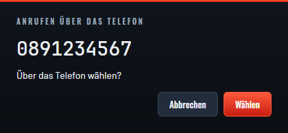
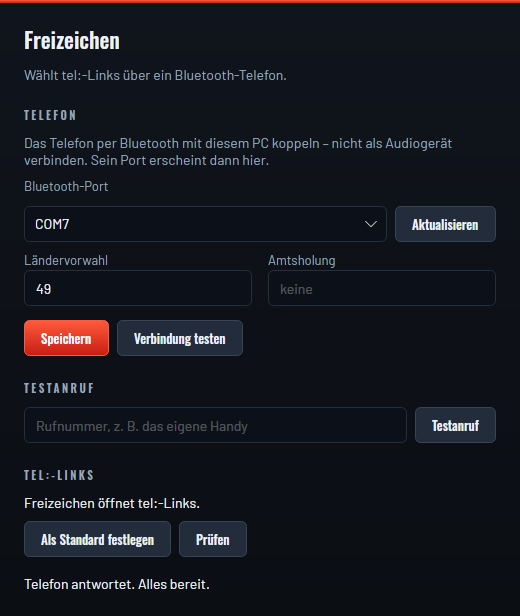
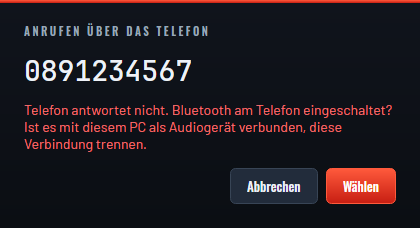

<h1 align="center">Freizeichen</h1>

<p align="center">
  <strong>Ein Klick auf die Nummer – das Telefon wählt.</strong><br />
  <code>tel:</code>-Links über ein Gigaset DL500A, per Bluetooth.
</p>

<p align="center">
  <a href="https://github.com/CodeForFire/freizeichen/actions/workflows/ci.yml"></a>
  <a href="../../releases"></a>
  <a href="../../releases"></a>
  <a href="LICENSE"></a>
  <a href="https://scorecard.dev/viewer/?uri=github.com/CodeForFire/freizeichen"></a>
</p>

<p align="center">
  
</p>

Ein Klick auf eine Telefonnummer in [Lagebuch](https://github.com/CodeForFire/lagebuch) – oder in
jedem anderen Programm, das `tel:`-Links öffnet – zeigt ein kleines Fenster mit der Nummer. Nach
*Wählen* baut das Gigaset DL500A den Anruf auf; das Gespräch wird am Telefon geführt.

Kein Gigaset QuickSync, kein TAPI, keine CSTA-Lizenz, kein Server.

*English speakers: the developer documentation starts at [For developers](#for-developers).*

## Wofür?

Im ELW steht das Telefon neben dem Laptop, und die Nummer steht auf dem Bildschirm: im Lagebuch
bei der Einsatzkraft, im Alarmfax, auf einer Webseite. Abtippen kostet Zeit und geht im Einsatz
auch mal schief. Freizeichen macht aus jeder `tel:`-Nummer einen Klick – Lagebuch selbst muss dafür
nichts über das Telefon wissen, es erzeugt nur gewöhnliche `tel:`-Links.

## So funktioniert es

Das DL500A stellt über Bluetooth eine serielle Schnittstelle (SPP) bereit und versteht dort
AT-Befehle wie ein Modem. Freizeichen öffnet diese Schnittstelle, sendet `ATD <Nummer>` und schließt
sie wieder. Der Anruf bleibt danach an der Basis bestehen.

Wie das Protokoll gefunden wurde: [CodeForFire/lagebuch#617](https://github.com/CodeForFire/lagebuch/issues/617).

## Voraussetzungen

- Ein **Gigaset DL500A** mit eingeschaltetem Bluetooth.
- Ein PC mit Bluetooth, auf dem das Telefon **gekoppelt** ist.
- Das Telefon ist **nicht als Audiogerät** (Freisprechen/Headset) mit dem PC verbunden. Solange
  diese Audioverbindung besteht, antwortet das DL500A auf der seriellen Schnittstelle nicht –
  siehe [Fehlerbehebung](#fehlerbehebung).

## Installation

Die Pakete liegen unter [Releases](../../releases).

| System | Paket | Erster Start |
|---|---|---|
| **Windows** (x64) | `freizeichen-<version>-windows-x64.msi` ausführen | SmartScreen → „Weitere Informationen“ → „Trotzdem ausführen“ |
| **macOS** | `.dmg` öffnen (`arm64` für Apple-Chips, `x64` für Intel), Freizeichen in „Programme“ ziehen | Rechtsklick auf Freizeichen.app → „Öffnen“ |
| **Linux** (x64) | Debian/Ubuntu: `sudo apt install ./freizeichen_<version>_amd64.deb`; sonst `freizeichen-<version>-linux-x64.tar.gz` entpacken | Port mit `rfcomm bind` anlegen, Benutzer in die Gruppe `dialout`; beim `.tar.gz` „Als Standard festlegen“ |

Die Pakete sind noch nicht signiert. Ob ein Download unverändert ist, zeigt `SHA256SUMS.txt` im
Release: `sha256sum -c SHA256SUMS.txt` (Linux) bzw. `shasum -a 256 -c SHA256SUMS.txt` (macOS).

## Einrichten



Freizeichen ohne Nummer starten – es öffnet die Einstellungen.

1. Das DL500A in den Bluetooth-Einstellungen des PCs **koppeln**, nicht als Audiogerät verbinden.
2. Unter **Bluetooth-Port** den Port des Telefons wählen: unter Windows ein ausgehender
   COM-Port, unter macOS `/dev/cu.…`, unter Linux `/dev/rfcomm0`.
3. **Ländervorwahl** und, falls die Leitung eine braucht, **Amtsholung** eintragen,
   **Speichern**.
4. **Verbindung testen** – „Telefon antwortet. Alles bereit.“ Ein **Testanruf** auf das eigene
   Handy zeigt, dass auch das Wählen klappt.
5. **Als Standard festlegen**, damit `tel:`-Links künftig bei Freizeichen landen.

Internationale Nummern im eigenen Land werden zur nationalen Form: `tel:+49 89 1234567` wählt
`0891234567`.

<br clear="right" />

## Sicherheit

Ein `tel:`-Link kann von jeder Webseite und jedem Dokument kommen. Freizeichen behandelt ihn
deshalb als fremde Eingabe:

- **Nichts wird ohne Bestätigung gewählt.** Jeder Link öffnet das Wählfenster; in der ersten
  Sekunde nach dem Öffnen löst nicht einmal *Enter* den Anruf aus, damit ein Tastendruck, der für
  ein anderes Programm gedacht war, nicht wählt.
- **Zum Telefon gelangen nur Ziffern** (und ein führendes `+`), höchstens 32 davon. Ein Link kann
  so keine eigenen AT-Befehle anhängen und keine Dienstkennzahlen wie `*21*…#` für eine
  Rufumleitung an der Vermittlungsstelle auslösen.

Sicherheitslücken bitte vertraulich melden – siehe [SECURITY.md](SECURITY.md).

## Fehlerbehebung



**„Telefon antwortet nicht.“** Fast immer besteht noch eine Audioverbindung (Freisprechen) vom PC
zum DL500A. Dann wird die serielle Verbindung nicht abgelehnt, sondern läuft ins Leere. In den
Bluetooth-Einstellungen des PCs die Audioverbindung trennen – gekoppelt bleibt das Telefon.

**„Port … nicht gefunden.“** Das Telefon ist nicht (mehr) gekoppelt, oder unter Linux fehlt
`rfcomm bind`. Koppeln, dann in den Einstellungen **Aktualisieren**.

**„Port … ist belegt.“** Ein anderes Programm hält die Schnittstelle offen, oder ein Anruf läuft
noch.

<br clear="right" />

## Ohne Telefon testen

Unter Linux spielt `tools/fake-dl500a.py` ein DL500A auf einem Pseudo-Terminal und zeigt jede
Zeile, die Freizeichen sendet:

```sh
make fake-phone                     # legt /dev/rfcomm9 an (fragt per sudo), SCENARIO=ok
make run                            # Einstellungen: /dev/rfcomm9 wählen, „Verbindung testen“
make run ARGS=tel:0891234567        # Wählfenster
```

`SCENARIO` steuert die Antwort auf `ATD`: `ok`, `error`, `busy`, `nocarrier`, `nodialtone` oder
`silent` – Letzteres antwortet gar nicht, wie das DL500A bei bestehender Audioverbindung.

## Mitmachen

Fehler gefunden, Idee, anderes Telefon? [Issues](../../issues) und
[Discussions](../../discussions) sind offen – in den Discussions gern auf Deutsch.
Wie Pull Requests aussehen sollen, steht in [CONTRIBUTING.md](CONTRIBUTING.md).

---

## For developers

Freizeichen is a small .NET 10 / Avalonia 12 desktop app for Windows, macOS and Linux. It
registers as the operating system's `tel:` handler, shows a confirm window and sends `ATD` to a
Gigaset DL500A over Bluetooth SPP. It exists so that [Lagebuch](https://github.com/CodeForFire/lagebuch)
and every other program in the ELW can keep emitting plain `tel:` links.

### Build and run

Prerequisite: the .NET SDK pinned in [`global.json`](global.json) (10.x).

```sh
make ci                          # restore (locked), build, test, format check — what CI runs
make run                         # settings window
make run ARGS=tel:0891234567     # dial window
make fake-phone                  # a fake DL500A on /dev/rfcomm9 (Linux, needs sudo)
make screenshots                 # regenerate docs/screenshots/ for this README
make icon                        # re-render the app icon from src/Freizeichen.App/Assets/icon.svg
make help                        # everything else
```

On Linux the phone appears as a serial port only after `sudo rfcomm bind 0 <phone-mac> 1`.
*Als Standard festlegen* writes `~/.local/share/applications/freizeichen.desktop`, pointing at the
running executable, and makes it the `x-scheme-handler/tel` default with `xdg-mime`. The `.deb`
(built by `packaging/linux/build-linux.sh`) also installs a system entry under the same name in
`/usr/share/applications`, so a user entry written later shadows it.

### Layout

| Project | What it holds |
|---|---|
| `Freizeichen.Domain` | `tel:` parsing (`TelUri`), number normalisation, settings. References nothing. |
| `Freizeichen.Modem` | The AT dial session over an `IAtChannel`, and the serial port. |
| `Freizeichen.AppLogic` | View models (CommunityToolkit.Mvvm). No Avalonia reference, so it is testable without a UI. |
| `Freizeichen.App` | Views, `Program`, the composition root and the per-OS `tel:` registration. |

Packaging lives in [`packaging/`](packaging/): a WiX MSI for Windows and a `.dmg` for macOS, built
by [`release.yml`](.github/workflows/release.yml) when a `v*` tag is pushed.

### Contributing

- [CONTRIBUTING.md](CONTRIBUTING.md): setup, commit rules (Conventional Commits, DCO sign-off,
  signed commits) and pull requests.
- [AGENTS.md](AGENTS.md): the architecture and code conventions in full, also read by coding agents.
- [SECURITY.md](SECURITY.md): how to report a vulnerability.
- [CODE_OF_CONDUCT.md](CODE_OF_CONDUCT.md).

## Lizenz / Licence

[MIT](LICENSE) © 2026 Thomas Müller. Bundled fonts and libraries are listed with their licences in
[THIRD-PARTY-NOTICES.md](THIRD-PARTY-NOTICES.md).
